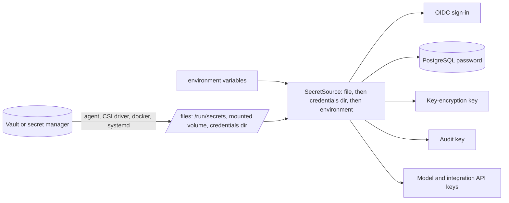
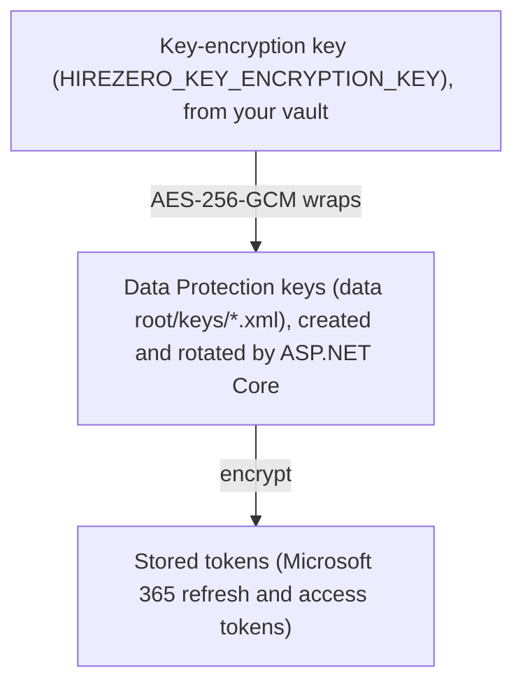

# Secrets in HireZero

This guide explains how HireZero handles secrets: what they are, where it reads them from, how they stay protected
at rest, and how to run them with a vault. It assumes no prior vault experience. The decision record is
[ADR 0027](adr/0027-secrets-from-files.md).

## 1. The ideas in two minutes

A **secret** is any value that grants access if someone else learns it:
- a password or an API key;
- an OAuth client secret;
- an encryption key.

Secrets must not be in source code or ordinary settings files, which get copied, committed and shared.

A **vault** (secret manager) is a service built to keep secrets:
- it stores them encrypted;
- it controls who may read each one;
- it records every read;
- it helps rotate them.

Examples are HashiCorp Vault and its open-source fork OpenBao, AWS Secrets Manager, Google Secret Manager, Azure Key
Vault, 1Password, Infisical and Doppler.

**Rotation** means replacing a secret with a new one, regularly or after a suspected leak. Good rotation needs no
downtime: the program picks up the new value while it runs.

**Delivery** is the part most people miss. A vault holds secrets, but something has to get each secret into the
running program. There are two ways:

1. **The program calls the vault's API itself.** This needs that vault's SDK, credentials to reach the vault, and
   code for each vault.
2. **Something next to the program writes the secret into a file**, and the program just reads the file. This is how
   Docker secrets, Kubernetes secrets, systemd credentials, Vault Agent, OpenBao Agent and the cloud CSI drivers work.

HireZero uses the second way, so it works with any vault, or none, without depending on one.

## 2. The one rule: secrets are read by name

Every secret has a name, such as `HIREZERO_OIDC_CLIENT_SECRET`. When HireZero needs it, it looks in this order and
takes the first it finds:

| Order | Where | Typical use |
| --- | --- | --- |
| 1 | The file named by `HIREZERO_OIDC_CLIENT_SECRET_FILE` | Kubernetes, vault agents, anything with a mounted file |
| 2 | A file called `HIREZERO_OIDC_CLIENT_SECRET` (or lowercase) in `$CREDENTIALS_DIRECTORY` or `/run/secrets` | systemd credentials, Docker secrets |
| 3 | The `HIREZERO_OIDC_CLIENT_SECRET` environment variable | A laptop, quick trials |
| 4 | Local mode only: a value pasted under Company → Integrations (section 4) | One person's own machine |

A trailing newline in a file is ignored, so `echo value > file` works. Files are read every time the secret is
used, so changing the file is enough to rotate it (see section 6).

Environment variables still work, but files are better:
- other processes and crash reports can sometimes see a program's environment;
- environment variables are copied into child processes;
- they are easy to print by accident.

The code is `src/HireZero.Core/Secrets.cs`.



## 3. Every secret HireZero reads

| Name | What it is for | When missing | Rotation |
| --- | --- | --- | --- |
| `HIREZERO_OIDC_CLIENT_SECRET` | Hosted sign-in: proves HireZero to your identity provider | Sign-in uses PKCE only (public client) | Change the file; the next sign-in uses it |
| `HIREZERO_TLS_CERTIFICATE_PASSWORD` | Opens the HTTPS certificate when HireZero terminates TLS itself | The certificate must not have a password | Restart (the certificate loads at startup) |
| `HIREZERO_DATABASE` | PostgreSQL connection string for hosted installs | Company data stays in SQLite in the data root | Restart |
| `HIREZERO_DATABASE_PASSWORD` | The PostgreSQL password, kept out of the connection string | The password is in the connection string, if anywhere | Change the file; new connections use it within 5 minutes |
| `HIREZERO_KEY_ENCRYPTION_KEY` | Encrypts the keys that protect stored tokens (section 4) | DPAPI on Windows; **unencrypted** elsewhere | Section 6 |
| `HIREZERO_KEY_ENCRYPTION_KEY_PREVIOUS` | The key-encryption key before the last rotation | Keys wrapped by an older key cannot be opened | Remove after 90 days |
| `HIREZERO_AUDIT_KEY` | Signs the audit chain; hosts sharing one database need the same one | An `audit.key` file in the data root, created once | Never (it is the chain's identity) |
| `HIREZERO_ANTHROPIC_API_KEY` | Employees' model through Anthropic's API, with `HIREZERO_API_MODELS=1` | `anthropic/*` routes go through OpenRouter, if set | Create a new key, update the file, revoke the old key |
| `HIREZERO_OPENAI_API_KEY` | Employees' model through OpenAI's API, with `HIREZERO_API_MODELS=1` | `openai/*` routes go through OpenRouter, if set | Create a new key, update the file, revoke the old key |
| `HIREZERO_OPENROUTER_API_KEY` or `OPENROUTER_API_KEY` | OpenRouter: structured choices, and employees' model for any route with `HIREZERO_API_MODELS=1` | The provider is unavailable | Change the file; the next call uses it |
| `HIREZERO_JEV_API_KEY` or `TYPESAFE_API_KEY` | The Jev choice service | Jev is unavailable | Change the file |
| `HIREZERO_SEMAFORGE_API_KEY` | SemaForge | SemaForge is unavailable | Change the file |
| `HIREZERO_GOOGLE_ADS_DEVELOPER_TOKEN` | Your Google Ads API developer token | Google Ads is unavailable | Reset it in the API Center, update the file |
| `HIREZERO_GOOGLE_ADS_CLIENT_SECRET` | The OAuth client secret used to sign in to Google Ads | Google Ads is unavailable | Add a secret to the OAuth client, update the file, delete the old one |
| `HIREZERO_GOOGLE_ADS_REFRESH_TOKEN` | The read-only user's refresh token for Google Ads | Google Ads is unavailable | Authorize again, update the file, revoke the old grant |
| `HIREZERO_GOOGLE_ADS_CHANGE_REFRESH_TOKEN` | Optional: the refresh token of a Google Ads user who may edit, used only for approved changes | Ad changes are off; reads are unaffected | Authorize again, update the file, revoke the old grant |
| `HIREZERO_GOOGLE_SERVICE_ACCOUNT` | The Google service account key (JSON) for read-only GA4 and Search Console | Google analytics is unavailable | Add a new key to the service account, update the file, delete the old key |

At startup, the log lists each configured secret, where it came from and how stored keys are protected. It never
shows a value:

```
Secret HIREZERO_OIDC_CLIENT_SECRET: file (/run/secrets/oidc-client-secret)
Secret HIREZERO_OPENROUTER_API_KEY: environment; prefer a mounted file, which other processes cannot read from the environment
Stored token keys are protected by key-encryption key.
```

## 4. Secrets HireZero stores itself

Some secrets are created while HireZero runs. For example, when an owner connects Microsoft 365, HireZero receives
tokens. These are kept in the data root, encrypted in layers:



- **Data Protection** is ASP.NET Core's built-in encryption for application data. It creates its own keys,
  replaces them every 90 days and keeps old ones so old data can still be read.
- Those keys are files, so they need protecting too. That is the **key-encryption key's** job (envelope encryption):
  - with `HIREZERO_KEY_ENCRYPTION_KEY`, every key file is encrypted with it, on any OS;
  - without it, on Windows, DPAPI ties the key files to the Windows user;
  - without it, on macOS and Linux, the key files are plain. They are protected only by file permissions, and the
    startup log says so.

For anything beyond one person's machine, supply a key-encryption key. The code is
`src/HireZero.Host/CompanyKeyProtection.cs`.

**Secrets pasted in the app** ([ADR 0038](adr/0038-integration-setup-in-the-app.md)) use the same layers. In local
mode, the Integrations section accepts the secrets that integrations declare: the Google key, the Google Ads tokens
and the OpenRouter key.
- Host secrets are never accepted there: the database, audit, key-encryption and sign-in secrets.
- Each value is encrypted with Data Protection into `data root/secrets/NAME.secret`. That directory is owner-only on
  macOS and Linux.
- A pasted value is never sent back to a page. The page shows only where each secret comes from.
- It is read last, so a file, credential directory or environment variable of the same name always wins. The page says
  when a pasted value is being ignored.
- Setting or removing one is recorded in the audit log by name, never by value.
- Hosted mode refuses pasted secrets: deliver them from your vault as above.

The **audit key** signs the tamper-evident audit log ([ADR 0022](adr/0022-tamper-evident-audit-log.md)). By default
it is `audit.key` in the data root. When several hosts share one PostgreSQL database, give them the same
`HIREZERO_AUDIT_KEY`. To move an existing install to a secret, use the contents of its current `audit.key` as the
secret's value. HireZero refuses to start if the two differ, rather than split the chain.

## 5. Recipes

### Make a key

A key-encryption key is 32 random bytes in base64. An audit key is 32 random bytes in hex:

```bash
openssl rand -base64 32     # HIREZERO_KEY_ENCRYPTION_KEY
openssl rand -hex 32        # HIREZERO_AUDIT_KEY
```

```powershell
[Convert]::ToBase64String([Security.Cryptography.RandomNumberGenerator]::GetBytes(32))
[Convert]::ToHexString([Security.Cryptography.RandomNumberGenerator]::GetBytes(32))
```

Put each straight into your vault or secret file. Do not paste it into chat, tickets or source. Back it up in the
vault: losing the key-encryption key means reconnecting Microsoft 365, and losing the audit key means the existing
chain cannot be verified.

### One machine (local mode)

Nothing is required. On Windows, stored keys use DPAPI. Model API keys can stay in your user environment, or in a
file you point to:

```powershell
$env:HIREZERO_OPENROUTER_API_KEY_FILE = "$HOME\.hirezero-secrets\openrouter"
```

### Docker Compose

Compose mounts each secret at `/run/secrets/<name>`, which HireZero reads directly:

```yaml
services:
  hirezero:
    image: hirezero:1.0.0
    environment:
      HIREZERO_PUBLIC_URL: https://hirezero.example.com/
      HIREZERO_TRUSTED_PROXY: 10.0.0.2
      HIREZERO_OIDC_AUTHORITY: https://login.example.com
      HIREZERO_OIDC_CLIENT_ID: hirezero
      HIREZERO_OWNER_LOGIN: owner@example.com
    secrets:
      - source: oidc
        target: HIREZERO_OIDC_CLIENT_SECRET
      - source: kek
        target: HIREZERO_KEY_ENCRYPTION_KEY
secrets:
  oidc:
    file: ./secrets/oidc-client-secret
  kek:
    file: ./secrets/key-encryption-key
```

### Kubernetes

Store the values in a Kubernetes Secret, or let a vault sync them into one. Mount it as files and point at them:

```yaml
env:
  - name: HIREZERO_OIDC_CLIENT_SECRET_FILE
    value: /var/run/hirezero/oidc-client-secret
  - name: HIREZERO_DATABASE_PASSWORD_FILE
    value: /var/run/hirezero/database-password
volumeMounts:
  - name: hirezero-secrets
    mountPath: /var/run/hirezero
    readOnly: true
volumes:
  - name: hirezero-secrets
    secret:
      secretName: hirezero
```

Kubernetes updates mounted secret files when the Secret changes, so rotation reaches HireZero without restarting the
pod. Use mounted files, not `env: valueFrom: secretKeyRef`: values loaded into environment variables do not update.
The cloud secret managers' **Secrets Store CSI driver** mounts secrets from AWS, Google, Azure or Vault the same way.

### A Linux VM with systemd

systemd keeps credentials out of the environment and makes them readable only by the service:

```ini
[Service]
LoadCredential=HIREZERO_OIDC_CLIENT_SECRET:/etc/hirezero/oidc-client-secret
LoadCredential=HIREZERO_KEY_ENCRYPTION_KEY:/etc/hirezero/key-encryption-key
```

HireZero finds them in `$CREDENTIALS_DIRECTORY` by name. `systemd-creds encrypt` can keep the source files
encrypted with the machine's TPM.

### HashiCorp Vault or OpenBao, through the agent

The agent signs in to the vault, renders each secret to a file, and re-renders it when the secret changes:

```hcl
template {
  contents    = "{{ with secret \"kv/data/hirezero\" }}{{ .Data.data.oidc_client_secret }}{{ end }}"
  destination = "/var/run/hirezero/oidc-client-secret"
  perms       = "0400"
}
```

Then set `HIREZERO_OIDC_CLIENT_SECRET_FILE=/var/run/hirezero/oidc-client-secret`. HireZero never talks to the
vault, so changing vaults changes only the agent's configuration.

## 6. Rotating each secret

| Secret | Steps |
| --- | --- |
| OIDC client secret | Create a second secret at the identity provider. Update the file. Sign in once to check. Delete the old secret at the provider. |
| API keys | Create a new key with the provider. Update the file. Revoke the old key. |
| Database password | Update the file and `ALTER ROLE … PASSWORD` together. Connections pick it up within 5 minutes. To avoid a gap, use two roles and switch between them, or let a vault's database engine manage it. |
| Key-encryption key | Move the current value to `HIREZERO_KEY_ENCRYPTION_KEY_PREVIOUS`. Put a new key in `HIREZERO_KEY_ENCRYPTION_KEY`. Restart. New key files use the new key, and old ones still open with the previous one. Remove the previous key after 90 days, when Data Protection has replaced the old key files. |
| Audit key | Do not rotate it. To retire a chain, export it with its verified head ([ADR 0022](adr/0022-tamper-evident-audit-log.md)) before starting a new data root. |
| TLS certificate password | Replace the certificate and its password, and restart. A reverse proxy that terminates TLS avoids this. |

## 7. What this protects against, and what it does not

**It protects against:**
- secrets in source code, settings files or the repository;
- secrets visible in a process's environment or copied to child processes, when files are used;
- copies of the data root (such as a backup) revealing stored tokens, when a key-encryption key is used;
- one host's audit chain silently differing from another's.

**It does not protect against:**
- someone with full control of the running machine or container, who can read whatever HireZero can;
- a leaked key-encryption key together with a copy of the data root;
- secrets pasted into prompts, chats or tasks. Employee runs mask secret-named variables in stored output, but the
  owner remains responsible for not typing secrets into work.

## 8. Glossary

| Term | Meaning |
| --- | --- |
| Secret | A value that grants access if known: password, API key, client secret, encryption key |
| Vault / secret manager | A service that stores secrets encrypted, controls and records access, and helps rotate them |
| Agent / sidecar | A small program next to an app that fetches secrets from a vault and writes them to files |
| CSI driver | A Kubernetes plugin that mounts secrets from a secret manager as files |
| systemd credentials | systemd's way to give a service secret files that only it can read |
| Rotation | Replacing a secret with a new one, ideally without downtime |
| Envelope encryption | Encrypting data with a key, and that key with another key (the key-encryption key) |
| DPAPI | Windows' built-in encryption tied to a user or machine |
| Data Protection | ASP.NET Core's built-in encryption for application data, with automatic key rotation |
| HMAC | A keyed hash; the audit log uses one so that only the key holder can produce valid entries |
| PKCE | A sign-in protection that lets a client prove itself without a client secret |

## 9. Questions to ask later

- Should HireZero talk to a vault directly, for leases or database credentials created on demand? It can be added as
  an optional `HireZero.Integrations.OpenBao` project, with no change to Core or roles.
- Should the owner see the startup secret report in the UI, as well as in the log?
- Non-secret settings are typed and validated, and can come from a settings file. See [SETTINGS.md](SETTINGS.md).
